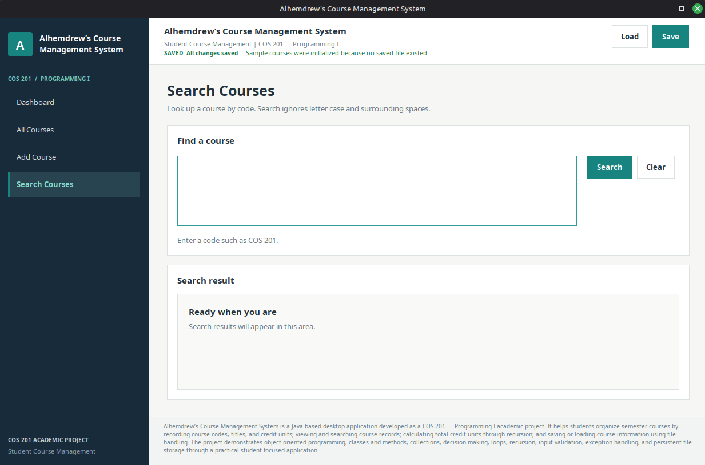
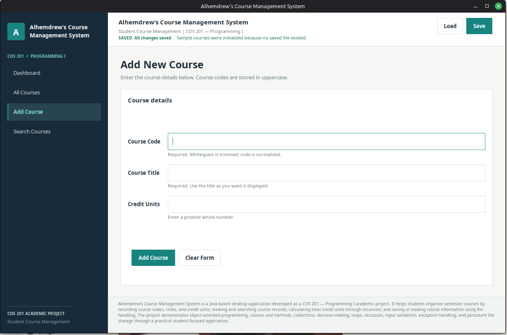

 <div align="center">

# Alhemdrew’s Course Management System

### A Java Swing Desktop Application for Managing Academic Course Records

[](https://www.java.com/)
[](https://docs.oracle.com/javase/tutorial/uiswing/)
[](#data-storage)
[](#academic-context)
[](#licensing-and-academic-use)

**Organise courses. Track credit units. Save your records.**

</div>

---

## About the Project

**Alhemdrew’s Course Management System** is a Java desktop application developed as a practical **COS 201 — Programming I** project.

The project demonstrates how foundational programming concepts can be applied to a simple academic record-management task through a graphical user interface.

Users can register courses, browse and search course records, view the number of registered courses and their combined credit units, and save or load records through a local text file.

The application brings together object-oriented programming, collections, input validation, string processing, recursion, exception handling, and file input/output in one practical project.

> **Academic-use notice:** This repository is subject to a temporary academic-use restriction while the project awaits grading. Please read the licensing section before attempting to reuse or redistribute the code.

## Features

- **Course registration:** Add a course using its code, title, and credit units.
- **Input validation:** Reject invalid course details and duplicate course codes.
- **Course directory:** Browse course records in a structured table.
- **Course-code search:** Find courses using their codes.
- **Live dashboard:** View course counts and total credit units.
- **File persistence:** Save course records and load them in later sessions.
- **Error handling:** Receive feedback when input or file operations fail.
- **Desktop interface:** Interact with the system through Java Swing.
- **Sample records:** A fresh setup can initialise sample courses when no course data file exists.

## Technology Stack

<div align="center">


</div>

| Technology | Purpose |
|---|---|
| Java | Main programming language |
| Java Swing | Desktop graphical user interface |
| Object-oriented programming | Separates course data and application responsibilities |
| Java collections | Holds course records in memory |
| File input/output | Saves and restores course records |
| Exception handling | Handles input and file-operation errors |
| Recursion | Demonstrates recursive calculation of total credit units |
| Git and GitHub | Version control and repository hosting |

## Requirements

Before running the application, ensure you have:

1. **Java Development Kit (JDK) 17 or later** recommended.
2. A terminal or command prompt.
3. The project source files.
4. Permission to access and use the repository under the terms in the licensing section.

Check whether Java is installed:

```bash
java -version
javac -version
```

Both commands should display a compatible Java version. If either command is unavailable, install a JDK and configure your system's `PATH`.

## Installation and Setup

### Step 1 — Obtain the project

After the repository becomes available for permitted use, clone it:

```bash
git clone https://github.com/alhemdrew/SCMSMIVA.git
cd SCMSMIVA
```

Replace the repository name if the final GitHub repository uses a different name.

Alternatively, download the repository as a ZIP file through GitHub and extract it.

### Step 2 — Check the project structure

The expected project structure is similar to:

```text
SCMSMIVA/
├── src/
│   ├── Main.java
│   ├── Course.java
│   ├── CourseManager.java
│   ├── MainFrame.java
│   └── AppTheme.java
├── data/
│   └── courses.txt
├── README.md
├── PROJECT_REPORT.md
└── .gitignore
```

The exact contents may change as the project develops.

### Step 3 — Compile the source code

Open a terminal in the project root directory and run:

```bash
mkdir -p out
javac -d out src/*.java
```

On Windows Command Prompt, use:

```bat
if not exist out mkdir out
javac -d out src\*.java
```

If compilation succeeds, the compiled class files will be placed in the `out` directory.

### Step 4 — Launch the application

Run the following command from the project root:

```bash
java -cp out Main
```

The application window should open.

**Important:** Run the application from the project root so that the relative `data/courses.txt` path resolves correctly.

### Step 5 — Test the main features

1. Review the course records and dashboard totals.
2. Add a course with a unique course code, title, and valid credit units.
3. Search for a course using its code.
4. Confirm that the dashboard totals update.
5. Save the course records.
6. Close and reopen the application.
7. Load the saved records and confirm that they remain available.

## Data Storage

The application stores course records locally in:

```text
data/courses.txt
```

Each course is represented by one line in a pipe-separated format:

```text
COURSE_CODE|COURSE_TITLE|CREDIT_UNITS
```

Example:

```text
COS 201|Programming I|3
MTH 201|Mathematics II|3
CSC 205|Introduction to Computer Science|3
```

The example contains three courses with three credit units each, giving a combined total of nine credit units.

Keep the `data` directory available when running the application. If you manually edit the file, preserve the expected format.

## Project Structure

| File | Responsibility |
|---|---|
| `Main.java` | Application entry point |
| `Course.java` | Represents a course and validates course details |
| `CourseManager.java` | Manages course records, search, totals, and persistence |
| `MainFrame.java` | Implements the Swing interface and user workflows |
| `AppTheme.java` | Centralises interface styling |
| `data/courses.txt` | Stores course records between sessions |
| `PROJECT_REPORT.md` | Contains the academic project report |

## Programming Concepts Demonstrated

- **Classes and objects:** Represent individual courses using Java objects.
- **Methods:** Organise course registration, searching, calculations, and persistence.
- **Collections:** Manage multiple course records in memory.
- **Decision-making and loops:** Process inputs and course records.
- **String processing:** Normalise course codes for consistent matching.
- **Recursion:** Demonstrate recursive calculation of total credit units.
- **Exception handling:** Handle input and file-operation problems.
- **File input/output:** Preserve records between application sessions.
- **Graphical user interface:** Use Java Swing to interact with the system.

## Troubleshooting

### `javac` is not recognised

Install a JDK rather than only a Java runtime. Confirm that `javac -version` works and configure `PATH` if necessary.

### The application cannot find course data

Run the application from the project root and confirm that the `data` directory exists.

### Compilation fails

Confirm that you are in the correct directory and that all required Java files are present in `src/`. Start by resolving the first compiler error.

### A course is rejected

Check that all required fields are filled in, the credit units are valid, and the course code has not already been registered.

## Limitations

This is an introductory academic project, not a production university information system.

The current version uses local file storage instead of a database. It does not currently provide course editing or deletion, multi-user access, authentication, or synchronisation between computers.

## Academic Context

This application was developed for **COS 201 — Programming I** as a practical demonstration of foundational Java programming concepts.

The project connects programming theory with a working desktop application that supports course management, validation, calculations, and file persistence.

**Author:** Andrew Moses (Alhemdrew Davenchi)  
**GitHub profile:** https://github.com/alhemdrew  
**Project repository:** Add the final repository URL here after creating the GitHub repository.

## Screenshots

Place your two genuine application screenshots in a `screenshots/` directory.

For example:

```text
screenshots/
├── dashboard.png
└── course-records.png
```

Then display them here:



*The main dashboard, showing course information and summary totals.*



*The course directory and search interface.*

Replace these filenames if your screenshots use different names. Use screenshots captured from the actual running application.

## Licensing and Academic Use

### Temporary academic restriction — through 15 November 2026

This project is currently being prepared for academic assessment and is awaiting grading.

Until **15 November 2026 inclusive**, no permission is granted to copy, reuse, modify, redistribute, publish derivative versions of, or submit this source code as another person's academic work.

The repository may be visible on GitHub, but visibility does not grant permission to reuse the code. Do not present the source code, report, or screenshots as your own work.

### Planned permission — from 16 November 2026

Beginning **16 November 2026**, the author intends to permit use, modification, and redistribution under the MIT License, subject to the licence text committed to the repository on or after that date.

Until the effective date, the planned permission is not yet in force. Consult the repository's `LICENSE` file for the authoritative terms and effective date.

This notice explains the intended transition from temporary academic restriction to a permissive licence. It is not a substitute for the final licence file.

---

<div align="center">

**Built by Alhemdrew Davenchi**

*Learning by building. Building by learning.*

</div>
